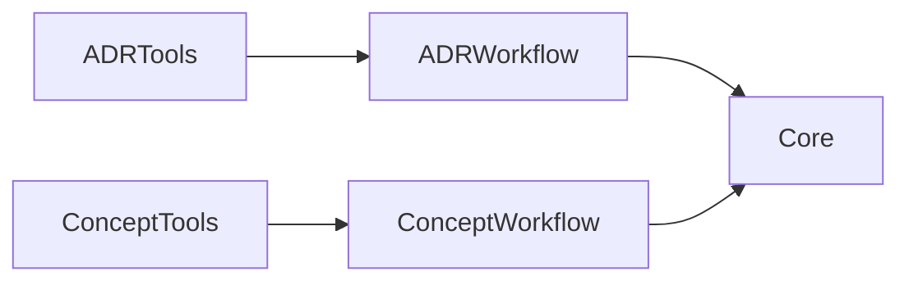

# ADR and Concept Workflows

## Description
The document workflow layer implements the richer collection-specific behavior. ADR handling assigns sequence numbers, validates the combined Nygard/ITD fields, enforces accepted-content immutability, and updates supersede links. Concept handling validates kinds and references and renders status and Related decisions sections.

## Diagram

## Responsibilities
- Create, read, edit, and supersede ADRs
- Create, read, and edit architecture concepts
- Validate references and render canonical generated sections

## Interfaces
- Chapter 9 and chapter 8 MCP tools
- Local chapter Markdown files
- Shared core document functions
