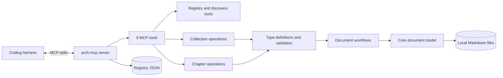

# arch-mcp System

## Description
The diagram shows the main runtime and code boundaries. The harness launches the MCP server through stdio. The server exposes root tools plus generic collection and chapter operations. Type-specific definitions provide validation and rendering; handlers share the core document model to access local Markdown. The registry remains server-owned local configuration.

## Diagram

## Responsibilities
- Expose the nine-tool MCP interface
- Validate collection and chapter content
- Preserve readable Markdown with lightweight discovery metadata

## Interfaces
- Coding harness through MCP stdio
- Local registry JSON file
- Local architecture Markdown directories
