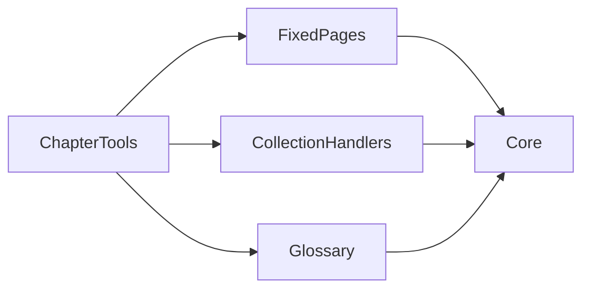

# Chapter Document Workflows

## Description
The chapter and collection workflows keep content in Markdown bodies while exposing chapter/type-specific guidance on demand. Quality scenarios are grouped in one body table per quality attribute, and glossary terms are H2 sections in one page.

## Diagram

## Responsibilities
- Read and section-edit fixed pages in chapters 1–4
- Create, read, and edit typed records in chapters 5–9 and 11
- Maintain chapter 10 quality-attribute pages with scenario tables
- Maintain chapter 12 terms through H2 section operations

## Interfaces
- collection_add/read/edit for collection types
- chapter_read/edit for fixed pages and glossary
- Markdown files in the corresponding chapter directories
- Shared core document functions
