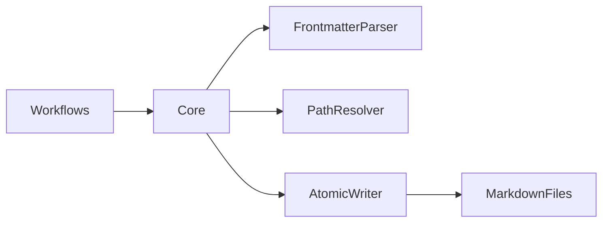

# Core Document Model

## Description
The core package contains the shared file model used by the server. It parses YAML frontmatter separately from the Markdown body, renders deterministic documents, resolves arc42 chapter paths, lists Markdown files, and writes through temporary-file replacement. Per-path in-process serialization and expected hashes protect normal single-server edits.

## Diagram

## Responsibilities
- Parse and render Markdown files with YAML frontmatter
- Resolve chapter directories and safe document IDs
- Compute content hashes and perform atomic, hash-checked writes

## Interfaces
- Exports from packages/core/src/index.ts
- Local filesystem paths
