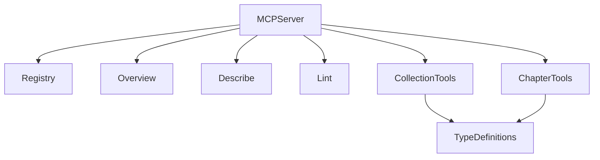

# MCP Tool Registration

## Description
The registration layer exposes a compact set of root, collection, and chapter operations. Type-specific semantics are selected through parameters and provided on demand by arch_describe. Validation stays in the server so its errors can explain missing fields, invalid diagrams, and likely corrections.

## Diagram

## Responsibilities
- Register the nine stable MCP tools
- Route collection and chapter types to the corresponding definitions
- Provide on-demand examples and actionable validation errors

## Interfaces
- MCP SDK McpServer registration API
- Loose JSON tool envelopes
- Collection and chapter definitions
- Document workflow handlers
