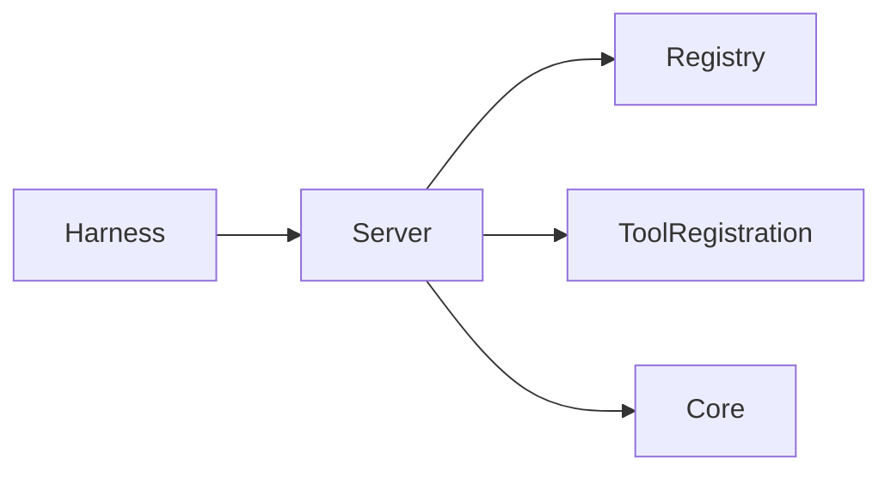

# Registry and MCP Server

## Description
The server package owns the global JSON registry and MCP process entry point. Registry entries map an architecture ID to a canonical local path and may specify enabled chapters. On startup, the tool set is registered based on the union of enabled chapters across registrations; registry changes to that set require a server restart.

## Diagram

## Responsibilities
- Load and persist the global architecture registry
- Start the MCP stdio server
- Resolve optional architecture IDs and chapter enablement

## Interfaces
- MCP stdio protocol
- ~/.config/arch-mcp/registry.json or ARCH_MCP_CONFIG
- @arch-mcp/core
