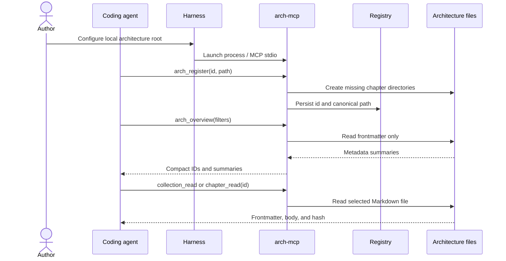

# Register and Browse an Architecture

## Trigger
An author configures arch-mcp for a repository that contains an architecture documentation directory.

## Participants
- Coding harness
- AI coding agent
- arch-mcp stdio server
- Local architecture directory
- Global registry file

## Diagram

## Steps
The diagram shows registration followed by progressive discovery. The overview keeps the initial response compact; the agent reads a full body only after selecting a relevant document. The server communicates with the harness over stdio and operates on local registry and documentation files.

## Outcome
The agent has a registered local architecture, a compact index, and the full relevant document without broad repository searches.
