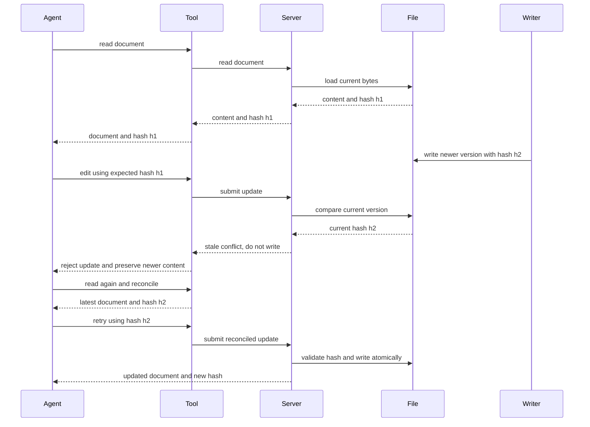

# Reject a Stale Document Edit

## Trigger
The Markdown file changes after the agent reads it but before the agent submits an edit.

## Participants
- AI coding agent
- collection_read and collection_edit or chapter_read and chapter_edit
- MCP server
- Local Markdown file

## Diagram

## Steps
The diagram shows both the successful read path and the stale-write rejection. The content hash is a version token for the exact file bytes; after a mismatch, the agent rereads and reconciles instead of retrying with the stale token. Per-path serialization is limited to one server process, so independent processes remain a documented concurrency risk.

## Outcome
The newer file is not silently overwritten; the agent receives a conflict and can perform a deliberate merge.
