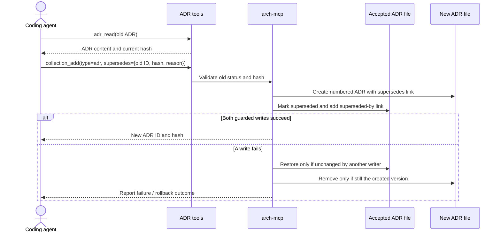

# Supersede an Accepted ADR

## Trigger
An author determines that a previously accepted ADR no longer represents the desired architecture decision.

## Participants
- AI coding agent
- ADR tools
- MCP server
- Chapter 9 Markdown files

## Diagram

## Steps
The supersede tool coordinates the two records: the replacement points back to the accepted ADR, while the old ADR points forward and displays its new status. The server uses guarded writes and attempts rollback if the second update fails; this is a best-effort multi-file operation, not a filesystem-wide transaction. Run arch_lint afterward to check the chain.

## Outcome
The new and old ADRs are linked in frontmatter and generated Status sections, or the operation reports failure and rolls back its writes where unchanged.
