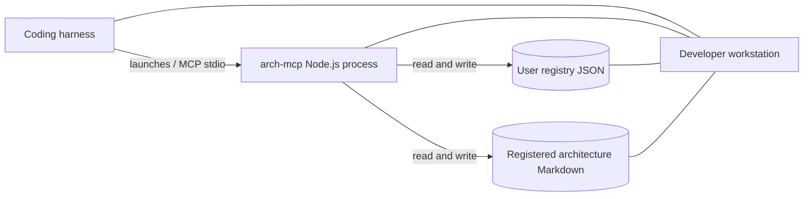

# Local Harness Deployment

## Description
All nodes run on the developer workstation. The harness launches the MCP server as a child process and exchanges JSON-RPC messages over stdin/stdout.

The server reads the registry at startup and operates only within registered local architecture roots.

The globally linked npm command points to this checkout for local testing; it is not required for deployment and does not change the runtime topology.

## Diagram

